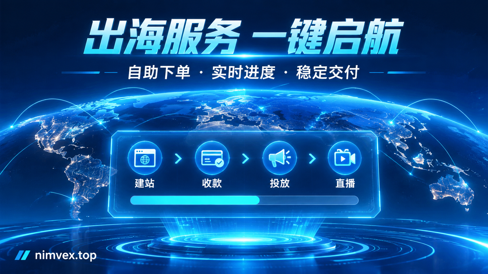
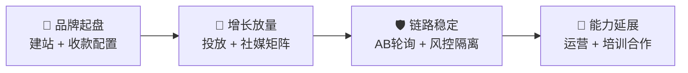

# 🚀 出海这门生意，别再一个人摸索

**建站、收款、投放、运营 —— 你的跨境增长基础设施，一站式配齐**

*独立站建站 · 跨境收款 · 广告代投 · 社媒矩阵 · 无人直播 · 店铺代运营 · 培训合作*

---

## 😮‍💨 做跨境，你是不是也卡在这几步？

> 建站没转化、收款总掉线、投放接不住 —— **这是 90% 跨境团队踩过的坑。**

| ❌ 单打独斗的日常 | ✅ 我们的解法 |
| :--- | :--- |
| 找 5 个服务商对接 5 遍需求，进度全靠催 | **一个门户自助下单**，订单进度实时可查 |
| 建站上线了，广告一来站点就崩，转化动线一团糟 | 建站从第一天就按 **广告承接 + 成交转化** 标准搭建 |
| 收款通道说封就封，订单高峰期支付直接掉线 | **AB 轮询 + 风险隔离**，多通道兜底，链路可监控可回退 |
| 投放烧钱像抽奖，社媒账号永远做不起来 | **广告代投 + 社媒矩阵 + 无人直播**，成体系放量 |
| 做完一个项目服务商就消失 | 以 **业务结果** 为导向，按阶段持续复盘迭代 |

---

## 🛫 Nimvex · 出海服务站 —— 让你今天下单，明天开工

**像点外卖一样点出海服务。** 全品类业务在线自助下单，无需反复比价砍价、无需漫长沟通排期。

**[👉 nimvex.top —— 打开门户，自助下单](https://nimvex.top/)**

### 为什么跨境团队都用它？

- 🛒 **全品类自助下单** —— 独立站建站、收款配置、广告代投、社媒涨粉、无人直播，7×24 在线下单
- 📊 **进度实时透明** —— 每一单都有清晰的交付节点和进度状态，不再"全靠催"
- 🛡️ **稳定交付承诺** —— 标准化履约流程，交付质量可预期、可追溯
- 🌍 **全链路一站打通** —— 建站承接 → 支付转化 → 流量增长 → 长期运营，不用东拼西凑

---

## ⚡ PayXPro · 跨境增长平台 —— 不止交付，更交付一套增长系统

**把"分散的能力"整合成"完整的系统"。** 不做一锤子买卖，而是围绕建站、支付、投放、运营搭建你的线上商业基础设施。

**[👉 payxpro.co —— 获取你的阶段增长方案](https://payxpro.co/)**

### 四大模块，覆盖你的整条增长链路

| 模块 | 覆盖内容 | 你得到什么 |
| :--- | :--- | :--- |
| 🧱 **品牌与站点底座** | Shopify / WooCommerce / 品牌官网 / B2B 询盘站 | 站点不只上线，更承担 **广告承接与成交转化** |
| 💳 **支付与收款基础设施** | PayPal / Stripe / Square + AB 跳转、轮询支付、风险隔离 | 收款不只是接入，更 **稳定、可监控、可回退** |
| 📈 **增长与运营系统** | 广告代投、店铺代运营、社媒矩阵、无人直播 | 增长不只看流量，更看 **协同效率** |
| 🤝 **内容矩阵与培训合作** | 培训陪跑、能力延展 | 交付不只靠经验，更靠 **结构化方法** |

### 按你的阶段，匹配你的方案

---

## 🎯 适合谁用？

| 你是谁 | 推荐入口 |
| :--- | :--- |
| 🔰 想做 Shopify 独立站 / 品牌官网但不知从哪起步的新手 | **[nimvex.top](https://nimvex.top/)** 自助下单建站 |
| 💳 被收款稳定性卡脖子、通道频繁掉线的卖家 | **[payxpro.co](https://payxpro.co/)** 支付链路方案 |
| 📣 需要广告代投 / 社媒矩阵 / 无人直播放大流量的品牌方 | 两个平台均可，按阶段组合 |
| 🏢 要一站式托管、按结果交付的成熟出海团队 | **[payxpro.co](https://payxpro.co/)** 系统化方案 |

---

## ❓ 高频问题

**Q：Shopify 独立站建站多少钱？多久上线？**
支持 Shopify、WordPress、WooCommerce 等主流方案，按业务阶段配置主题、支付入口、物流规则与数据追踪，具体以门户内服务明细为准，下单后进度实时可查。

**Q：跨境收款总是掉线怎么解决？**
通过 AB 分流、多账户轮询、权重分配、备用入口与异常兜底策略，降低单通道波动对成交的影响，覆盖 PayPal、Stripe、Square 等主流场景。

**Q：不会投广告、做不起来直播怎么办？**
提供国内外广告代投、社媒矩阵布局与无人直播体系，从账号搭建到内容投放全链路代运营。

**Q：服务跑路了怎么办？**
订单全流程线上留痕、进度实时透明，以业务结果为导向持续复盘 —— 不是做完一个项目就结束。

---

## 🔑 关键词索引

`出海服务站` `跨境电商` `独立站建站` `Shopify建站` `WordPress建站` `WooCommerce` `跨境收款` `AB轮询支付` `收款通道` `PayPal收款` `Stripe` `广告代投` `Facebook投放` `Google投放` `TikTok Ads` `社媒矩阵` `无人直播` `店铺代运营` `品牌出海` `跨境支付` `流量增长` `直播带货` `跨境培训` `出海工具` `独立站运营`

---

## 🚀 现在就开始

| 🛫 出海服务站（自助下单 · 即买即开工） | ⚡ PayXPro（增长系统 · 阶段化方案） |
| :---: | :---: |
| **[nimvex.top](https://nimvex.top/)** | **[payxpro.co](https://payxpro.co/)** |

**你的出海生意，值得一套更稳的基础设施。**

---

> 💡 本页面由 Nimvex & PayXPro 团队维护 · 持续更新出海实战内容 · 觉得有用请顺手 **Star** ⭐
